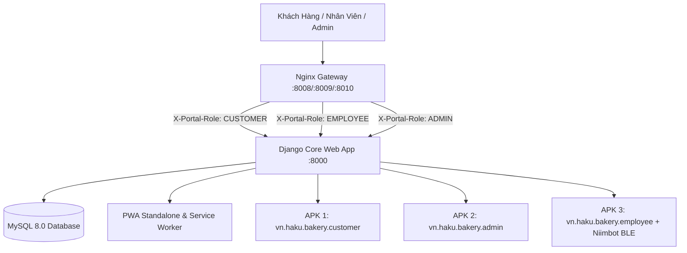

# 📖 ARTISAN BAKERY - PROJECT BIBLE
## Hệ Thống Quản Lý Tiệm Bánh Thủ Công • PWA Standalone & 3 Ứng Dụng APK Android

---

## 1. TỔNG QUAN KIẾN TRÚC HỆ THỐNG MULTI-PORTAL

Hệ thống **Artisan Bakery** được vận hành trên kiến trúc **Multi-Portal (Đa Cổng Dịch Vụ)** nghiêm ngặt. Nginx đóng vai trò Reverse Proxy phân luồng người dùng qua từng Cổng riêng biệt và truyền định danh qua HTTP Header `X-Portal-Role` vào Django Middleware ([PortalAccessMiddleware](file:///home/haku/bakery/apps/dashboard/middleware.py)):



### Bảng Phân Luồng 3 Cổng & Ứng Dụng:

| Cổng / Vai Trò | Cổng Dev | Cổng Prod | Subdomain Dự Kiến | Mã Package APK | Kiến Trúc Ứng Dụng | Tính Năng Trọng Tâm & Phân Quyền In Tem |
| :--- | :--- | :--- | :--- | :--- | :--- | :--- |
| **Khách Hàng (Customer)** | `8008` | `9008` | `customer.example-trusted-bakery.org` | `vn.haku.bakery.customer` | **Phương án 1 (TWA / Standalone Web Shell)** | Xem menu bánh, giỏ hàng online, đặt bánh sinh nhật theo hẹn, theo dõi trạng thái làm bánh, ví điểm thành viên VIP. *(Không in tem)* |
| **Quản Trị (Admin)** | `8010` | `9010` | `admin.example-trusted-bakery.org` | `vn.haku.bakery.admin` | **Phương án 1 (TWA / Standalone Web Shell)** | Bảng điều khiển doanh thu, cấp tài khoản & quản lý nhân viên, quản trị món bánh & mã coupon, kho hàng & cấu hình VietQR. **Được phép in tem nhãn bánh & quản trị mọi mẻ bánh.** |
| **Nhân Viên (Employee/POS/Kitchen)** | `8009` | `9009` | `employee.example-trusted-bakery.org` | `vn.haku.bakery.employee` | **Phương án 3 (Native Shell + Niimbot Bluetooth Driver)** | Gồm 2 vai trò nghiệp vụ:<br>• **Thu ngân (Cashier)**: Quẹt mã vạch trên bánh, tính tiền, in hóa đơn thanh toán. **Tuyệt đối KHÔNG được in tem bánh**.<br>• **Thợ làm bánh (Baker)**: Quản lý mẻ nướng (KDS/BOM), nghiệm thu ra lò và **ĐƯỢC QUYỀN in tem nhiệt Niimbot (50x30mm) dán túi bánh**. |

---

## 2. FRONTEND DESIGN SYSTEM

Hệ thống sử dụng bảng màu và kiểu chữ tùy biến cho môi trường quầy POS và web mobile:

### 2.1 Bảng Màu Cốt Lõi (Warm Palette)
- **Cream**: `#FAF6F0` (Nền ứng dụng)
- **Vanilla**: `#FFFDF9` (Nền thẻ card, modal)
- **Crust**: `#261309` (Màu chữ chính)
- **Caramel**: `#78350F` (Màu phụ đề, text mô tả)
- **Honey / Amber Gold**: `#D97706` & `#B45309` (Màu thương hiệu, nút hành động)
- **Fresh Herb**: `#15803D` (Bánh mới, tồn kho sẵn sàng)
- **Berry Alert**: `#DC2626` (Bánh cận hạn -40%, hết hàng, cảnh báo)

### 2.2 Typography & Hình Khối
- **Font**: `Plus Jakarta Sans` (400, 500, 600, 700, 800)
- **Border Radius**: `rounded-2xl` (16px) và `rounded-3xl` (24px)
- **Shadows**: `shadow-amber-500/10` kết hợp viền `border-amber-100`

### 2.3 Phản Hồi Xúc Giác & Âm Thanh (Tactile Haptic UX)
- **Web Audio API (`SoundFX`)**:
  - `SoundFX.playClick()`: Âm gõ nhẹ khi chạm vào món bánh, nút danh mục.
  - `SoundFX.playSuccess()`: Hợp âm Chime C5-E5 vui tai khi hoàn thành đơn thanh toán hoặc in tem thành công.
  - `SoundFX.playBeep()`: Âm cảnh báo khi quét mã vạch hoặc thao tác lỗi.
- **Active State (`.btn-tactile`)**: Nút thu nhỏ nhẹ (`scale(0.96)`) khi chạm ngón tay vào màn hình cảm ứng điện thoại.

---

## 3. PWA STANDALONE ENGINE (ỨNG DỤNG ĐỘC LẬP TRÊN ĐIỆN THOẠI)

Khi người dùng mở web trên điện thoại (Safari iOS hoặc Chrome Android) và chọn *"Thêm vào màn hình chính"* (Add to Home Screen):
1. **Khởi Động Độc Lập**:
   - Khai báo `display: standalone` trong [manifest.webmanifest](file:///home/haku/bakery/static/manifest.webmanifest).
   - Ẩn hoàn toàn thanh URL và các nút điều hướng của trình duyệt, ứng dụng chiếm trọn màn hình điện thoại như ứng dụng tải từ App Store / Google Play.
2. **Hỗ Trợ Safe-Area (Tai Thỏ, Dynamic Island, Android Tràn Viền)**:
   - Áp dụng các biến CSS `env(safe-area-inset-top)` và `env(safe-area-inset-bottom)`.
   - Phần nội dung được tự động chừa khoảng cách an toàn, không bị che bởi thanh điều hướng đáy hoặc tai thỏ.
3. **Thanh Điều Hướng Đáy Thông Minh (Mobile Bottom Nav)**:
   - Gắn cố định ở đáy màn hình điện thoại, tự động chuyển đổi 4 tab theo từng vai trò cổng truy cập.
4. **Service Worker ([sw.js](file:///home/haku/bakery/static/sw.js))**:
   - Cache trước toàn bộ assets, logo, CSS, JS và font chữ.
   - Network-First cho dữ liệu đơn hàng và giỏ hàng.
   - Tự động hiển thị trang ngoại tuyến [offline.html](file:///home/haku/bakery/templates/offline.html) khi mất mạng kèm nút "Thử kết nối lại".
5. **Banner Mời Cài Đặt (PWA In-App Install Prompt)**:
   - Tự động bắt sự kiện `beforeinstallprompt` và hiển thị gợi ý *"Cài đặt Artisan Bakery vào màn hình chính"* đẹp mắt, có thể kích hoạt từ menu trượt (Mobile Drawer).

---

## 4. TÍCH HỢP MÁY IN NHIỆT NIIMBOT (MỔ XẺ TỪ APP NIIMBOT)

Từ việc mổ xẻ gói ứng dụng [JCYDY_GOOGLE.apk](file:///home/haku/bakery/thermo_printer/JCYDY_GOOGLE.apk), chúng ta đã trích xuất toàn bộ cấu trúc giao tiếp Bluetooth của máy in tem nhiệt Niimbot:

### 4.1 Thông Số Kỹ Thuật Giao Thức Niimbot
- **Các Dòng Máy Hỗ Trợ**: Niimbot B21, D11, D110, B1, B3S, JC series.
- **Bluetooth Low Energy (BLE)**:
  - Service UUID: `e7810a71-73ae-499d-8c15-faa9aef0c3f2`
  - Write / Notify Characteristic: `bef8d6c9-9c21-4c9e-b632-bd58c1009f9f`
- **Classic Bluetooth (SPP)**:
  - Serial Port Profile UUID: `00001101-0000-1000-8000-00805F9B34FB`

### 4.2 Cấu Trúc Khung Gói Tin (Niimbot Packet Framing)
Mỗi lệnh gửi tới máy in Niimbot đều có cấu trúc:
```
[0x55, 0x55, <Mã Lệnh>, <Độ Dài Data>, <Dữ Liệu N Bytes...>, <Checksum XOR>, 0xAA, 0xAA]
```
Trong đó:
- `Header`: `0x55, 0x55` (Bắt đầu gói tin)
- `Mã Lệnh`:
  - `0x01`: Bắt tay kết nối (Handshake)
  - `0x03`: Bắt đầu lệnh in (Print Start)
  - `0xD3`: Chọn loại nhãn giấy (Gap label - giấy có khe hở)
  - `0x85`: Gửi dữ liệu dòng điểm ảnh đơn sắc (Bitmap row packet)
  - `0x84`: Kết thúc trang nhãn (Page End)
  - `0xF3`: Kết thúc toàn bộ lệnh in (Print End)
  - `0xD4`: Đẩy giấy ra (Paper Feed)
- `Checksum`: Phép tính XOR liên tiếp: `Checksum = Mã_Lệnh ^ Độ_Dài ^ Byte_1 ^ Byte_2 ^ ... ^ Byte_N`
- `Tail`: `0xAA, 0xAA` (Kết thúc gói tin)

### 4.3 Trình Điều Khiển [niimbot-printer.js](file:///home/haku/bakery/static/js/niimbot-printer.js) & Cơ Chế Khớp Kích Thước Tem 50x30mm
- **Khớp Kỹ Thuật Với Thông Số Niimbot (50x30mm = Ngang 50mm, Dọc 30mm)**:
  - Đầu in nhiệt Niimbot (B21, B1, D110...) có độ phân giải chuẩn quốc tế: **203 DPI = 8 dots/mm**.
  - Chiều ngang cuộn giấy 50mm (khổ in khả dụng của đầu kim 48mm):
    $$\text{Width} = 48\text{mm} \times 8 = 384\text{ dots (điểm ảnh)}$$
    *(Chia hết hoàn hảo cho 8 bit: $384 / 8 = 48\text{ bytes}$ mỗi hàng in)*.
  - Chiều dọc cuộn giấy 30mm:
    $$\text{Height} = 30\text{mm} \times 8 = 240\text{ dots (hàng quét)}$$
  - Tổng kích thước Bitmap gửi xuống máy in là **384 × 240 pixels**, kết thúc bằng lệnh `CMD_PAGE_END (0x84)` giúp máy in dừng ngay tại khe hở (Gap sensor), tuyệt đối không lệch lề hay mất chữ.
- **Bộ Điều Chỉnh Kích Thước Linh Hoạt (Label Dimensions Selector)**:
  - **Presets Tích Hợp Sẵn**:
    1. `50 × 30 mm` (Mặc định chuẩn tiệm bánh Niimbot B21/B1)
    2. `40 × 30 mm` (Tem nhãn trung bình - 320 × 240 px)
    3. `50 × 25 mm` (Tem bánh dẹp - 384 × 200 px)
    4. `40 × 20 mm` (Tem nhỏ dán hộp - 320 × 160 px)
    5. `30 × 20 mm` (Tem mini Macaron / Cupcake - 240 × 160 px)
    6. `Tùy chỉnh (Ngang mm × Dọc mm)`: Nhập kích thước tự do theo cuộn giấy thực tế.
  - **Thuật Toán Co Giãn Tỷ Lệ (Adaptive Scaling)**: Tự động căn chỉnh kích thước phông chữ tên bánh, giá tiền, ngày nướng (NSX), hạn dùng (HSD) và vạch mã vạch Barcode 1D vừa khít với bất kỳ kích thước tem nào mà người dùng chọn.
  - **Tùy Chọn Đậm Nhạt (Thermal Density)**: Hỗ trợ 3 mức nhiệt: `1 (Nhẹ)`, `2 (Vừa)`, `3 (Đậm nét)` gửi trực tiếp qua lệnh `CMD_DENSITY (0x21)`.
  - **Ghi Nhớ Cấu Hình**: Tự động lưu khổ tem đã chọn vào `localStorage` trên máy nhân viên.
- **Phương Thức Kết Nối Kép**:
  - Khi chạy trên trình duyệt web: Sử dụng **Web Bluetooth API** (`navigator.bluetooth.requestDevice`).
  - Khi chạy trong App APK Nhân Viên: Sử dụng **Android Native Bridge** (`window.AndroidNiimbot.connect()` và `sendRaw()`) qua socket Bluetooth SPP trực tiếp của hệ điều hành!

### 4.4 Khả Năng Kết Nối Niimbot Trên iOS (iPhone/iPad) & Vấn Đề *.mobileconfig
1. **App nhân viên trên iOS có kết nối tới máy in Niimbot được không?**
   - **CÓ THỂ KẾT NỐI ĐƯỢC**, tuy nhiên do Apple khóa Web Bluetooth API trên Safari và Web Clip PWA mặc định, việc kết nối cần thực hiện theo 1 trong 2 giải pháp sau:
     - **Giải pháp 1 (Khuyên dùng - Nhanh nhất & Miễn phí)**: Sử dụng trình duyệt **Bluefy - Web BLE Browser** (tải trên App Store). Trình duyệt này hỗ trợ đầy đủ `navigator.bluetooth`. Mã nguồn `niimbot-printer.js` của chúng ta hoạt động 100% không cần chỉnh sửa!
     - **Giải pháp 2 (App Native IPA)**: Đóng gói app Native cho iOS bằng Swift/Capacitor tích hợp thư viện `CoreBluetooth`. Cách này cho trải nghiệm như app Android nhưng đòi hỏi máy Mac và tài khoản Apple Developer ($99/năm).
2. **Có nên/thể tạo file *.mobileconfig để kết nối Bluetooth trên iOS không?**
   - **CÂU TRẢ LỜI: KHÔNG NÊN VÀ KHÔNG THỂ DÙNG `.mobileconfig` ĐỂ KẾT NỐI BLUETOOTH.**
   - **Lý do từ Apple**: File cấu hình `*.mobileconfig` (Apple Configuration Profile) được Apple thiết kế cho MDM chỉ hỗ trợ: *Wi-Fi, VPN, Web Clip (ghim icon ra Home), Email, Passcode, Chứng chỉ SSL*. **Apple hoàn toàn KHÔNG CUNG CẤP bất kỳ payload nào cho phép ghép đôi hoặc kết nối Bluetooth/BLE.** Mọi kết nối Bluetooth trên iOS bắt buộc phải do người dùng cấp quyền trực tiếp trong runtime ứng dụng.
   - File cấu hình [artisan_bakery_employee.mobileconfig](file:///home/haku/bakery/mobile_apps/ios/artisan_bakery_employee.mobileconfig) đã được tạo sẵn trong dự án với mục đích **cài phím tắt Web Clip toàn màn hình** cho nhân viên nếu cần.

---

## 5. HỆ THỐNG MÀN HÌNH CẢNH BÁO & XỬ LÝ LỖI ĐỘC QUYỀN

Hệ thống đã thay thế các màn hình lỗi kỹ thuật mặc định thành giao diện trải nghiệm mang đậm phong cách tiệm bánh và quy định nội bộ:

### 5.1 Cảnh Báo Nhân Viên Vượt Quyền (HTTP 403 Forbidden - [templates/403.html](file:///home/haku/bakery/templates/403.html))
- **Mục tiêu**: Ngăn chặn thu ngân tự ý in tem mẻ bánh, nhân viên truy cập cấu hình quản trị hoặc gian lận mẻ nướng.
- **Thông điệp bắt buộc**:
  > **“Cảnh báo, admin đang theo dõi hoạt động của từng tài khoản, đừng vi phạm nội quy nhé!”**
- **Thông tin giám sát (Audit Log)**: Hiển thị thời gian thực tên tài khoản nhân viên (`username`), vai trò (`CASHIER`/`BAKER`), đường dẫn cố tình xâm phạm, địa chỉ IP, và cảnh báo vi phạm nội quy.
- **Thoát an toàn**: Nút đưa thu ngân về lại quầy POS, đưa thợ bánh về màn hình Bếp KDS.

### 5.2 Màn Hình Lỗi Thân Thiện Cho Khách Hàng (HTTP 404 Not Found - [templates/404.html](file:///home/haku/bakery/templates/404.html))
- **Mục tiêu**: Khi khách hàng truy cập đường dẫn chưa có trên hệ thống hoặc đang phát triển.
- **Thông điệp bắt buộc**:
  > **“Hình như chưa ai build đường dẫn này, bạn có muốn build không?”**
- **Hai nút tương tác**:
  - **Nút "Có"**: Khi click, trượt mở hộp liên hệ với nội dung:
    - *"Liên hệ admin để build"*
    - Hiển thị Email của Quản trị viên (`admin@bakery.local` / cấu hình hệ thống)
    - Nút *"Gửi Mail"* trực tiếp (`mailto:`) và nút *"Sao chép Email"* tự động.
  - **Nút "Không"**: Chuyển hướng khách hàng quay về trang chủ tiệm bánh (`/online/` hoặc `/`).

---

## 6. BỘ 3 ỨNG DỤNG APK ĐÃ BUILD & XUẤT BẢN


Các ứng dụng APK đã được biên dịch hoàn chỉnh bằng công cụ Android SDK chính thức (`aapt2`, `d8`, `zipalign`, `apksigner`) và ký bằng Release Keystore chuẩn:

```
/home/haku/bakery/dist_apk/
├── Artisan_Bakery_Customer.apk        (190 KB) - v1.0.1 (Build 2 - Khách Hàng)
├── Artisan_Bakery_Admin.apk           (190 KB) - v1.0.1 (Build 2 - Quản Trị Viên)
└── Artisan_Bakery_Employee_POS.apk    (198 KB) - v1.0.1 (Build 2 - POS & Bếp Kèm Niimbot)
```

---

## 7. CỔNG TẢI ỨNG DỤNG THÔNG MINH (/download)

Hệ thống cung cấp một đường dẫn duy nhất **`/download`** (hoặc `/download/`) không yêu cầu đăng nhập, tự động phát hiện thiết bị và điều hướng thông minh:

### 7.1 Nếu truy cập bằng Apple iOS (iPhone / iPad)
- Giao diện tự động chuyển sang hướng dẫn cài đặt PWA:
  - **Bước 1**: Mở liên kết bằng trình duyệt Safari.
  - **Bước 2**: Nhấn nút **Chia sẻ** `[ ⎋ ]` ở thanh dưới cùng Safari.
  - **Bước 3**: Chọn **"Thêm vào MH chính" (Add to Home Screen)** `[ ➕ ]`.
  - **Bước 4**: Nhấn **"Thêm" (Add)** để tạo biểu tượng app độc lập toàn màn hình.
- Đối với nhân viên dùng máy in Niimbot: Nhắc nhở sử dụng trình duyệt **Bluefy** (Web BLE Browser) trên App Store để in tem trực tiếp qua Bluetooth.

### 7.2 Nếu truy cập bằng Android (POCO C71, Xiaomi, Samsung...)
- Tự động phát hiện Cổng kết nối (Multiport) để đưa file APK chuẩn xác:
  - **Cổng 8008 (Customer)**: Đưa file **`Artisan_Bakery_Customer.apk`** (190 KB)
  - **Cổng 8009 (Employee)**: Đưa file **`Artisan_Bakery_Employee_POS.apk`** (198 KB - Kèm Niimbot Bluetooth Driver)
  - **Cổng 8010 (Admin)**: Đưa file **`Artisan_Bakery_Admin.apk`** (190 KB)
- Tự động kích hoạt tải xuống file APK sau 1.5 giây.
- Kèm hướng dẫn cài đặt 3 bước (cho phép cài đặt nguồn ngoài trên Xiaomi HyperOS / POCO C71).
- Danh sách tải chéo cả 3 app nếu người dùng muốn tải bản khác.
- Đường dẫn tải file nhị phân trực tiếp: `/download/apk/customer/`, `/download/apk/employee/`, `/download/apk/admin/`.

### 7.3 Nếu truy cập bằng Máy Tính (PC / Mac / Linux)
- Hiển thị thông báo chính thức:
  > **“App hiện không có sẵn cho PC, vui lòng sử dụng web app”**
- **Đếm ngược tự động 30 giây**:
  - Đồng hồ đếm ngược từ 30s về 0s kèm thanh tiến trình trực quan.
  - Sau 30 giây, tự động chuyển hướng người dùng về trang chủ Web App tương ứng.
  - Nút **`🏠 Quay Về Trang Chủ Ngay`** để bỏ qua thời gian chờ.
- **Mã QR Code**: Người dùng trên máy tính có thể quét mã QR bằng camera điện thoại để mở ngay trang tải app trên điện thoại của mình.

---


### Chi Tiết Cấu Hình & Quyền Của Từng Ứng Dụng:

#### 1. App Khách Hàng (`Artisan_Bakery_Customer.apk`)
- **Package ID**: `vn.haku.bakery.customer`
- **Tên Ứng Dụng**: `Artisan Tiệm Bánh`
- **URL Mặc Định**: `https://customer.example-trusted-bakery.org` (Cổng 8008/9008)
- **Quyền**: `INTERNET`, `ACCESS_NETWORK_STATE`
- **Mục Đích**: Trải nghiệm đặt bánh nhẹ mượt, tự động nhận dạng Cổng Khách Hàng.

#### 2. App Quản Trị (`Artisan_Bakery_Admin.apk`)
- **Package ID**: `vn.haku.bakery.admin`
- **Tên Ứng Dụng**: `Artisan Quản Trị`
- **URL Mặc Định**: `https://admin.example-trusted-bakery.org` (Cổng 8010/9010)
- **Quyền**: `INTERNET`, `ACCESS_NETWORK_STATE`, `WRITE_EXTERNAL_STORAGE`
- **Mục Đích**: Quản lý cửa hàng, tải báo cáo doanh thu Excel/PDF.

#### 3. App Nhân Viên (`Artisan_Bakery_Employee_POS.apk`)
- **Package ID**: `vn.haku.bakery.employee`
- **Tên Ứng Dụng**: `Artisan Thu Ngân & Bếp`
- **URL Mặc Định**: `https://employee.example-trusted-bakery.org` (Cổng 8009/9009)
- **Quyền Đặc Biệt**:
  - `BLUETOOTH`, `BLUETOOTH_ADMIN`, `BLUETOOTH_CONNECT`, `BLUETOOTH_SCAN`
  - `ACCESS_FINE_LOCATION` (cho quét thiết bị BLE)
  - `CAMERA` (cho quét mã vạch qua camera điện thoại)
  - `WAKE_LOCK` (giữ sáng màn hình liên tục khi làm việc tại quầy POS & lò nướng)
- **Tính Năng Bổ Sung**:
  - Chuyển đổi tab nhanh trên điện thoại giữa `[Menu Bánh]` và `[Hóa Đơn / Giỏ]`.
  - Tích hợp cầu nối Native `window.AndroidNiimbot` kết nối và in tem dán bánh trực tiếp tới máy Niimbot qua Bluetooth!

---

## 6. HƯỚNG DẪN BUILD LẠI VÀ CÀI ĐẶT APK

### 6.1 Lệnh Build Lại Toàn Bộ 3 APK (1-Click Build)
Mỗi khi có cập nhật trong thư mục mã nguồn `mobile_apps/`, bạn chỉ cần chạy 1 lệnh duy nhất:
```bash
./mobile_apps/build_all_apks.sh
```
Kịch bản sẽ tự động:
1. Đọc môi trường Android SDK & JDK 17.
2. Biên dịch tài nguyên qua `aapt2`.
3. Biên dịch mã nguồn Java và chuyển đổi thành `classes.dex` qua `d8`.
4. Căn chỉnh bộ nhớ 4-byte qua `zipalign`.
5. Ký số APK bằng Keystore `artisan_bakery.keystore` và kiểm tra tính toàn vẹn qua `apksigner`.
6. Xuất ra thư mục `dist_apk/`.

### 6.2 Thông Tin Signing Keystore
- **Đường Dẫn**: [mobile_apps/keystore/artisan_bakery.keystore](file:///home/haku/bakery/mobile_apps/keystore/artisan_bakery.keystore)
- **Alias**: `artisan_key`
- **Mật Khẩu Keystore**: `artisanbakery123`
- **Mật Khẩu Key**: `artisanbakery123`
- **Thời Hạn**: 10.000 ngày (hơn 27 năm).

### 6.3 Hướng Dẫn Cài Đặt Vào Thiết Bị Android
1. **Cài Đặt Trực Tiếp Qua File**:
   - Chép các file trong thư mục `dist_apk/` vào điện thoại hoặc máy POS Android qua cáp USB, Zalo, Google Drive, hoặc cắm thẻ nhớ.
   - Nhấn mở file `.apk` trên điện thoại và chọn *"Cài đặt"* (Bật cho phép cài đặt ứng dụng từ nguồn không xác định nếu có hỏi).
2. **Cài Đặt Qua Lệnh ADB (Nhanh Cho Kỹ Thuật Viên)**:
   ```bash
   adb install -r dist_apk/Artisan_Bakery_Customer.apk
   adb install -r dist_apk/Artisan_Bakery_Admin.apk
   adb install -r dist_apk/Artisan_Bakery_Employee_POS.apk
   ```

---
*Tài liệu được cập nhật bởi Hệ thống Trợ lý Antigravity cho dự án Artisan Bakery.*
